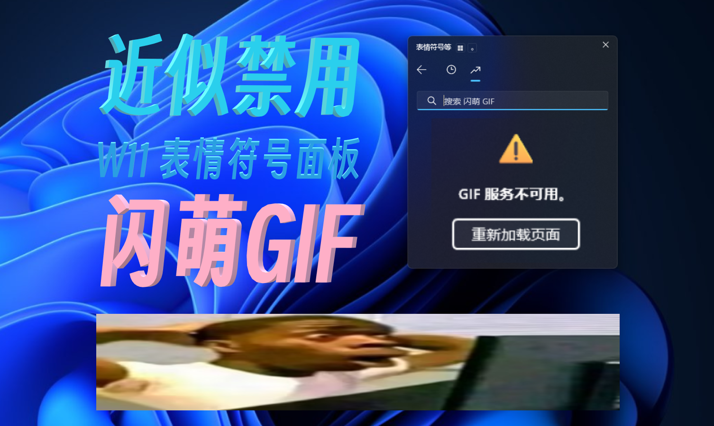

---

1. 打开`高级安全 Windows Defender 防火墙`
2. 点击左侧的**出站规则**，然后点击右侧的**新建规则**
3. 选择**程序**，点击**下一步**
4. 在**此程序路径**中粘贴：`C:\Windows\SystemApps\MicrosoftWindows.Client.CBS_cw5n1h2txyewy\TextInputHost.exe`
5. 选择**阻止连接**，点击**下一步**。
6. 勾选**所有配置文件（域、专用、公用）**，命名规则，点击**完成**。

---

> 注意：视频演示的方案并非原创！方案由d老师总结，如有雷同还请谅解qwq

> 因为表情符号面板本身以及剪贴板等其他功能不需要联网，阻止面板连接网络只会导致gif无法加载，不会影响其他功能的正常使用。

> 感谢您的观看！